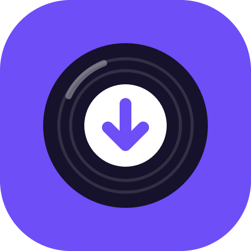

<p align="center"></p>

<h1 align="center">Clipnest</h1>
<p align="center"><em>Say it: CLIP-nest</em><br>A free, open-source desktop app to save YouTube and Instagram media as MP3 or MP4.</p>

<p align="center"><a href="https://github.com/vishnuvk2k/clipnest/releases/latest">Download for Windows and Mac</a> · <a href="LICENSE">MIT License</a> · <a href="https://github.com/vishnuvk2k/clipnest/issues">Report a problem</a></p>

## Features

- **MP3 audio** at 320, 256, 192 or 128 kbps, with cover art and title/artist tags
- **MP4 video** at 4K, 1440p, 1080p or 720p, with sound, optional subtitles
- **YouTube** videos, Shorts, music and whole playlists
- **Instagram** Reels and video posts, and Reel audio as MP3 (Instagram's audio pages
  can't be downloaded directly: use a Reel that uses the sound)
- Original files, **no watermark**, no ads, no account
- Download queue with progress, history, and auto-paste of copied links
- The download engine (yt-dlp) **updates itself** when Clipnest starts, so it keeps working when sites change

## Download

Everything is on the [Releases](https://github.com/vishnuvk2k/clipnest/releases/latest) page.

### Windows 10 and 11

- **`Clipnest-Setup-<version>.exe`** (recommended): a setup wizard that lets you choose the
  install folder, accept the license, and add Start Menu and desktop shortcuts. Uninstall from
  Windows Settings → Apps.
- **`Clipnest-Portable.exe`**: one file, no install. Starts a little slower.

> Windows SmartScreen may warn about an unknown publisher because the app isn't code-signed.
> Click **More info → Run anyway**.

### Mac (macOS 12 or later)

Pick the disk image for your Mac. Apple menu → **About This Mac** shows the chip:

- **`Clipnest-<version>-macOS-apple-silicon.dmg`** for M1, M2, M3 and M4 Macs
- **`Clipnest-<version>-macOS-intel.dmg`** for Intel Macs

Open the `.dmg` and drag **Clipnest** into **Applications**.

> The app isn't signed by Apple yet, so the first time macOS says it can't check it for
> malware. Open **System Settings → Privacy & Security**, scroll down and click **Open Anyway**
> next to Clipnest (on older macOS: right-click Clipnest in Applications → **Open**). After
> that it opens normally.

### First launch

Downloads are saved to your **Downloads** folder (change it in Settings).

On first launch Clipnest downloads its engine (yt-dlp, FFmpeg and Deno, about 150 MB) into
`%LOCALAPPDATA%\Clipnest` on Windows or `~/Library/Application Support/Clipnest` on a Mac.
After that it works offline apart from the downloads themselves.

## If a download fails

- **"Confirm you're not a bot" or a private Instagram post:** open **Settings → Logins**, choose
  the browser where you're logged in to YouTube/Instagram, close that browser, and try again.
- **A site changed and downloads stopped working:** **Settings → Check for updates**.

## Run from source

```bash
git clone https://github.com/vishnuvk2k/clipnest.git
cd clipnest
python -m venv .venv
.venv\Scripts\activate          # macOS/Linux: source .venv/bin/activate
pip install -r requirements-dev.txt
python Clipnest.py
```

Clipnest downloads yt-dlp, FFmpeg and Deno itself on Windows and macOS. On Linux install FFmpeg
with your package manager (`sudo apt install ffmpeg`); Clipnest downloads the rest.

Run the tests with `python -m pytest`. To build on Windows:

```bat
pyinstaller clipnest.spec                                  :: app folder in dist\Clipnest\
"C:\Program Files (x86)\Inno Setup 6\ISCC.exe" installer\clipnest.iss   :: dist\Clipnest-Setup-<version>.exe
set CLIPNEST_ONEFILE=1 && pyinstaller clipnest.spec          :: portable dist\Clipnest.exe
```

On a Mac, `pyinstaller clipnest.spec` makes `dist/Clipnest.app`.

GitHub Actions builds the Windows installer, the portable exe and both Mac disk images on every
push, and publishes them as a release when you push a tag such as `v1.2.0`. The icons and
installer artwork are generated by `tools/make_icon.py` and `tools/make_installer_images.py`.

## How it works

| File | What it does |
|---|---|
| `clipnest/app.py` | The window: download page, history, settings |
| `clipnest/downloads.py` | Runs downloads in the background, two at a time, with a queue |
| `clipnest/jobs.py` | Builds yt-dlp commands for each format and reads its progress |
| `clipnest/engine.py` | Installs and updates yt-dlp and FFmpeg |
| `clipnest/store.py` | Saves settings and history |
| `clipnest/theme.py` | Colors, styles, icons and the logo |

## Responsible use

Clipnest is a tool. Download only content you own, that's licensed for reuse (for example
Creative Commons), or that you otherwise have the right to save. Respect creators' copyright and
the terms of the sites you use. Clipnest isn't affiliated with YouTube, Google, Instagram or Meta.

## Credits and license

Made by **Vishnu VK**, built with [Claude Code](https://claude.com/claude-code).

Clipnest is MIT licensed (see [LICENSE](LICENSE)). It uses
[yt-dlp](https://github.com/yt-dlp/yt-dlp) (Unlicense), [FFmpeg](https://ffmpeg.org) (GPL build,
downloaded separately at runtime) and [Qt for Python](https://www.qt.io/qt-for-python) (LGPL).
