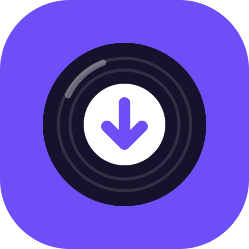

<p align="center"></p>

<h1 align="center">Clipnest</h1>
<p align="center"><em>Say it: CLIP-nest</em><br>A free, open-source desktop app for Windows and Mac that saves YouTube, Instagram, Facebook, X, Vimeo and Pinterest media as MP3 or MP4.</p>

<p align="center"><a href="https://github.com/vishnuvk2k/Clipnest/releases/latest"><b>Download for Windows and Mac</b></a> · <a href="LICENSE">MIT License</a> · <a href="https://github.com/vishnuvk2k/Clipnest/issues">Report a problem</a></p>

## Features

- **MP3 audio** at 320, 256, 192 or 128 kbps, with cover art and title/artist tags
- **MP4 video** at 4K, 1440p, 1080p or 720p, with sound and optional subtitles
- **YouTube** videos, Shorts, music and whole playlists
- **Instagram** Reels and video posts, and Reel audio as MP3
- **Facebook** videos and Reels, and **X** (Twitter) posts with video
- **Vimeo** videos
- **Pinterest** video pins, and image pins saved as the original full-size picture
- Original files, **no watermark**, no ads, no account
- A new download never replaces a file you already have: a second copy is saved as "Name (2)"
- Download queue with progress, history, and auto-paste of copied links
- The download engine **updates itself** when Clipnest starts, so it keeps working when sites change

## Download and install

Get the latest version from the [Releases page](https://github.com/vishnuvk2k/Clipnest/releases/latest).

### Windows 10 and 11

- **`Clipnest-Setup-<version>.exe`** (recommended): a setup wizard that lets you choose the
  install folder and adds Start Menu and desktop shortcuts. Uninstall from
  Windows Settings → Apps.
- **`Clipnest-Portable.exe`**: one file, no install. Starts a little slower.

The app isn't code-signed yet, so the first time Windows may say "Windows protected your PC".
Click **More info → Run anyway**.

### Mac (macOS 12 or later)

Pick the disk image for your Mac (Apple menu → **About This Mac** shows the chip):

- **`Clipnest-<version>-macOS-apple-silicon.dmg`** for M1, M2, M3 and M4 Macs
- **`Clipnest-<version>-macOS-intel.dmg`** for Intel Macs

Open the `.dmg` and drag **Clipnest** into **Applications**. The app isn't signed by Apple yet,
so the first time macOS blocks it:

1. Open Clipnest. When macOS warns you, click **Done** (not Move to Trash).
2. Open **System Settings → Privacy & Security**, scroll down and click **Open Anyway** next to
   Clipnest, then confirm with your password.

If macOS says **"Clipnest is damaged"**, open Terminal, run this once, then open Clipnest again:

```bash
xattr -cr /Applications/Clipnest.app
```

After the first time it opens normally.

## First launch

Downloads are saved to your **Downloads** folder; you can choose other folders in Settings.

On first launch Clipnest downloads its engine (yt-dlp, FFmpeg and Deno, about 150 MB) into
`%LOCALAPPDATA%\Clipnest` on Windows or `~/Library/Application Support/Clipnest` on a Mac.
After that it only needs the internet for the downloads themselves.

## If a download fails

- **Instagram, Vimeo, private Facebook or X posts, or YouTube's "confirm you're not a bot":**
  these need you to be logged in. Open **Settings → Logins**, choose the browser where you're
  logged in to that site, close that browser, and try again. Firefox works most reliably on
  Windows.
- **A site changed and downloads stopped working:** **Settings → Check for updates**.
- **Spotify** can't be downloaded: its music is protected with DRM.

## Run from source

```bash
git clone https://github.com/vishnuvk2k/Clipnest.git
cd Clipnest
python -m venv .venv
.venv\Scripts\activate          # macOS/Linux: source .venv/bin/activate
pip install -r requirements-dev.txt
python Clipnest.py
```

Clipnest downloads yt-dlp, FFmpeg and Deno itself on Windows and macOS. On Linux install FFmpeg
with your package manager (`sudo apt install ffmpeg`); Clipnest downloads the rest.

Run the tests with `python -m pytest`.

## Building

GitHub Actions builds every push: the Windows installer, the portable exe, and both Mac disk
images (Apple Silicon and Intel). Publishing a release with a tag such as `v1.4.0` attaches
them to the release automatically.

To build by hand:

```bat
:: Windows
pyinstaller clipnest.spec                                                :: app folder in dist\Clipnest\
"C:\Program Files (x86)\Inno Setup 6\ISCC.exe" installer\clipnest.iss    :: dist\Clipnest-Setup-<version>.exe
set CLIPNEST_ONEFILE=1 && pyinstaller clipnest.spec                        :: portable dist\Clipnest.exe
```

On a Mac, `pyinstaller clipnest.spec` makes `dist/Clipnest.app`. The icons and installer artwork
are generated by `tools/make_icon.py` and `tools/make_installer_images.py`.

## How it works

| File | What it does |
|---|---|
| `clipnest/app.py` | The window: download page, history, settings |
| `clipnest/downloads.py` | Runs downloads in the background, two at a time, then moves finished files into place |
| `clipnest/jobs.py` | Builds yt-dlp commands for each format and site, and reads its progress |
| `clipnest/engine.py` | Installs and updates yt-dlp, FFmpeg and Deno |
| `clipnest/browsers.py` | Finds installed browsers for logins |
| `clipnest/store.py` | Saves settings and history |
| `clipnest/theme.py` | Colors, styles, icons and the logo |
| `site/` | The download page at [vishnuvk2k.github.io/Clipnest](https://vishnuvk2k.github.io/Clipnest/) |

## Responsible use

Clipnest is a tool. Download only content you own, that's licensed for reuse (for example
Creative Commons), or that you otherwise have the right to save. Respect creators' copyright and
the terms of the sites you use. Clipnest isn't affiliated with YouTube, Google, Instagram,
Facebook, Meta, X, Vimeo or Pinterest.

## Credits and license

Made by **Vishnu VK**, built with [Claude Code](https://claude.com/claude-code).

Clipnest is MIT licensed (see [LICENSE](LICENSE)). It uses
[yt-dlp](https://github.com/yt-dlp/yt-dlp) (Unlicense), [FFmpeg](https://ffmpeg.org) (GPL build,
downloaded separately at runtime), [Deno](https://deno.com) (MIT) and
[Qt for Python](https://www.qt.io/qt-for-python) (LGPL).
